# Resultados da avaliação dos índices de perigo

_Gerado automaticamente em 20/10/2026 07:45._ Os números completos estão em `avaliacao.xlsx`.

> **EXEMPLO COM DADOS SIMULADOS – os números não são reais.**

## Parâmetros

| parâmetro | valor |
|---|---|
| período | 01/08/2025 a 30/09/2025 |
| dias usados | 60 |
| resolução da grade (°) | 0.250 |
| células na área de estudo | 781 |
| célula-dia com fogo = nº de focos ≥ | 1 |
| fuso aplicado aos focos (h) | -3 |
| filtro dos focos | {'Satelite': 'AQUA_M-T'} |
| focos na área de estudo (dias usados) | 18255 |
| somente dias comuns a todos os índices | sim |
| Índice proposto: classes | Baixo (código 1); Leve (código 2); Moderado (código 3); Alto (código 4) |
| Índice proposto: classe alta | a partir de Alto |
| RF INPE: classes | Mínimo (< 0.15); Baixo (0.15 a 0.4); Médio (0.4 a 0.7); Alto (0.7 a 0.95); Crítico (≥ 0.95) |
| RF INPE: classe alta | a partir de Alto |
| FWI GWIS (ranking): classes | abaixo de P50 (< P50); P50 a P90 (P50 a P90); acima de P90 (≥ P90) |
| FWI GWIS (ranking): classe alta | a partir de acima de P90 |
| FWI GWIS (ranking): climatologia | 1525 dias, 2000–2024 |
| Kappa ponderado: pesos | linear |

**Dias sem arquivo ou com erro:** 1 (ver aba `Arquivos_faltantes`).

## (a) Desempenho contra os focos de calor

Classe alta = a partir da classe indicada. Razão > 1 = a classe concentra mais focos do que o seu tamanho; SS = skill score (Heidke); POD = detecção; FAR = falso alarme.

| índice | região | classe alta | dias | % área em classe alta | % focos em classe alta | razão na classe alta | % sucesso | skill score (SS) | POD (%) | FAR (%) | Spearman % área alta (mesmo dia) | Spearman % área alta (dia seguinte) |
|---|---|---|---|---|---|---|---|---|---|---|---|---|
| Índice proposto | Paraguai | a partir de Alto | 60 | 9.43 | 31.99 | 3.39 | 75.57 | 0.230 | 22.71 | 33.81 | 0.871 | 0.726 |
| Índice proposto | Chaco | a partir de Alto | 60 | 14.97 | 39.29 | 2.62 | 70.50 | 0.248 | 29.01 | 32.91 | 0.919 | 0.837 |
| Índice proposto | Oriental | a partir de Alto | 60 | 1.86 | 7.97 | 4.28 | 82.49 | 0.076 | 5.92 | 43.63 | 0.715 | 0.677 |
| RF INPE | Paraguai | a partir de Alto | 60 | 19.52 | 49.14 | 2.52 | 74.88 | 0.308 | 39.83 | 43.92 | 0.862 | 0.788 |
| RF INPE | Chaco | a partir de Alto | 60 | 30.28 | 59.02 | 1.95 | 69.58 | 0.308 | 49.79 | 43.07 | 0.859 | 0.902 |
| RF INPE | Oriental | a partir de Alto | 60 | 4.82 | 16.62 | 3.44 | 82.14 | 0.144 | 13.26 | 51.20 | 0.752 | 0.640 |
| FWI GWIS (ranking) | Paraguai | a partir de acima de P90 | 60 | 12.13 | 29.27 | 2.41 | 72.97 | 0.180 | 22.90 | 48.12 | 0.710 | 0.875 |
| FWI GWIS (ranking) | Chaco | a partir de acima de P90 | 60 | 11.40 | 29.09 | 2.55 | 68.78 | 0.181 | 21.36 | 35.12 | 0.747 | 0.937 |
| FWI GWIS (ranking) | Oriental | a partir de acima de P90 | 60 | 13.14 | 29.89 | 2.27 | 78.70 | 0.188 | 27.01 | 63.53 | 0.834 | 0.944 |

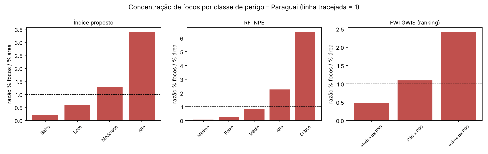

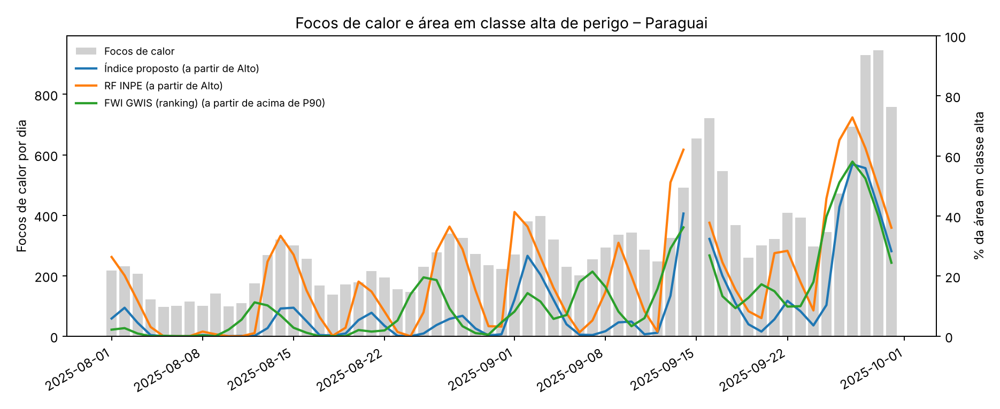

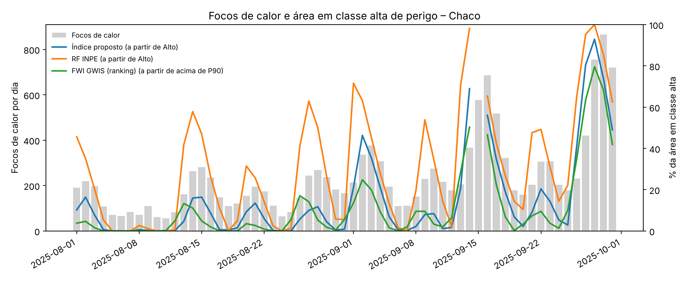

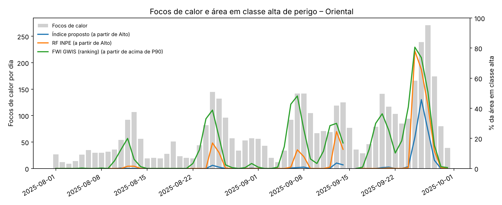

## (b) Comparação temporal entre os índices

Correlação de Spearman entre as séries diárias (% área Alto (classe comum)).

| região | índice A | índice B | n dias | rho de Spearman | p-valor |
|---|---|---|---|---|---|
| Paraguai | Índice proposto | RF INPE | 60 | 0.924 | 0.000 |
| Paraguai | Índice proposto | FWI GWIS (ranking) | 60 | 0.556 | 0.000 |
| Paraguai | RF INPE | FWI GWIS (ranking) | 60 | 0.576 | 0.000 |
| Chaco | Índice proposto | RF INPE | 60 | 0.932 | 0.000 |
| Chaco | Índice proposto | FWI GWIS (ranking) | 60 | 0.807 | 0.000 |
| Chaco | RF INPE | FWI GWIS (ranking) | 60 | 0.850 | 0.000 |
| Oriental | Índice proposto | RF INPE | 60 | 0.802 | 0.000 |
| Oriental | Índice proposto | FWI GWIS (ranking) | 60 | 0.720 | 0.000 |
| Oriental | RF INPE | FWI GWIS (ranking) | 60 | 0.685 | 0.000 |

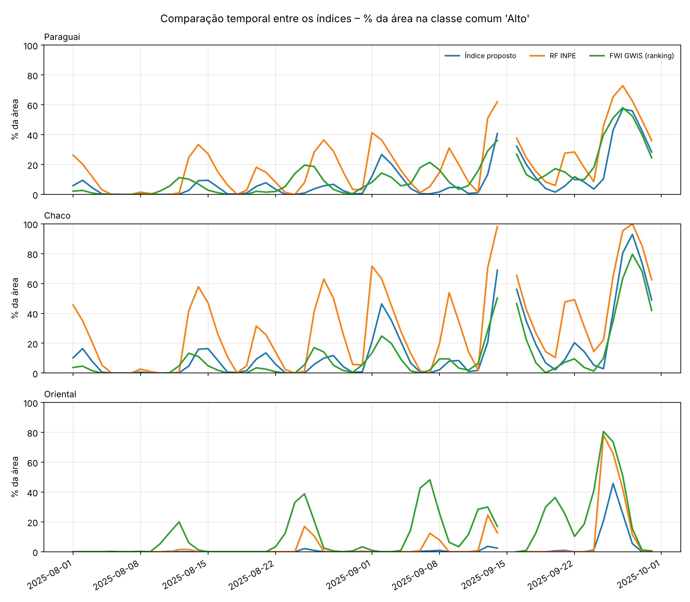

## (c) Comparação espacial nas datas selecionadas

### Equivalência de classes

| classe comum | Índice proposto | RF INPE | FWI GWIS (ranking) |
|---|---|---|---|
| Baixo | Baixo, Leve | Mínimo, Baixo | abaixo de P50 |
| Moderado | Moderado | Médio | P50 a P90 |
| Alto | Alto | Alto, Crítico | acima de P90 |

### Datas selecionadas

Percentis da série diária de focos: P alto = 497 focos, P baixo = 121 focos.

| data | grupo | focos | percentil na série | atende ao percentil |
|---|---|---|---|---|
| 05/08/2025 | menores registros | 97 | 1.67 | sim |
| 10/08/2025 | menores registros | 98 | 3.33 | sim |
| 14/08/2025 | maiores registros | 319 | 65.00 | não |
| 27/08/2025 | maiores registros | 340 | 75.00 | não |
| 06/09/2025 | menores registros | 201 | 28.33 | não |
| 12/09/2025 | menores registros | 248 | 43.33 | não |
| 16/09/2025 | maiores registros | 722 | 95.00 | sim |
| 29/09/2025 | maiores registros | 946 | 100.0 | sim |

### Concordância em todos os dias (Paraguai)

Dias separados em terços pela série de focos: baixa ≤ 221 focos, média ≤ 320, alta > 320.

| par | grupo de atividade | dias | % concordância (mediana) | Kappa ponderado (linear) – mediana |
|---|---|---|---|---|
| Índice proposto × RF INPE | baixa atividade | 20 | 55.76 | 0.217 |
| Índice proposto × RF INPE | média atividade | 20 | 53.07 | 0.209 |
| Índice proposto × RF INPE | alta atividade | 20 | 51.22 | 0.393 |
| Índice proposto × RF INPE | todos os dias | 60 | 53.33 | 0.243 |
| Índice proposto × FWI GWIS (ranking) | baixa atividade | 20 | 72.41 | 0.240 |
| Índice proposto × FWI GWIS (ranking) | média atividade | 20 | 53.59 | 0.274 |
| Índice proposto × FWI GWIS (ranking) | alta atividade | 20 | 56.91 | 0.352 |
| Índice proposto × FWI GWIS (ranking) | todos os dias | 60 | 60.88 | 0.287 |

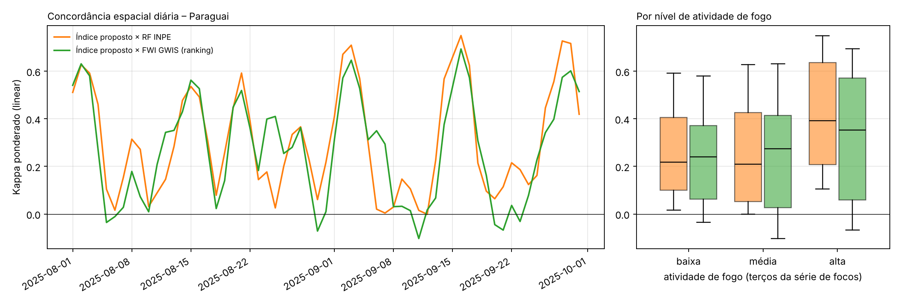

### Concordância nas datas ilustrativas (Paraguai)

| data | par | células | % concordância | Kappa | Kappa ponderado (linear) |
|---|---|---|---|---|---|
| 2025-08-05 | Índice proposto × RF INPE | 781 | 70.17 | 0.104 | 0.104 |
| 2025-08-10 | Índice proposto × RF INPE | 781 | 44.05 | 0.032 | 0.032 |
| 2025-08-14 | Índice proposto × RF INPE | 781 | 55.57 | 0.336 | 0.477 |
| 2025-08-27 | Índice proposto × RF INPE | 781 | 46.48 | 0.185 | 0.334 |
| 2025-09-06 | Índice proposto × RF INPE | 781 | 33.93 | 0.008 | 0.020 |
| 2025-09-12 | Índice proposto × RF INPE | 781 | 69.78 | -0.011 | -0.001 |
| 2025-09-16 | Índice proposto × RF INPE | 781 | 75.80 | 0.627 | 0.750 |
| 2025-09-29 | Índice proposto × RF INPE | 781 | 73.24 | 0.590 | 0.717 |
| todas as datas | Índice proposto × RF INPE | 6248 | 58.63 | 0.375 | 0.488 |
| 2025-08-05 | Índice proposto × FWI GWIS (ranking) | 781 | 77.46 | -0.036 | -0.036 |
| 2025-08-10 | Índice proposto × FWI GWIS (ranking) | 781 | 66.20 | 0.011 | 0.009 |
| 2025-08-14 | Índice proposto × FWI GWIS (ranking) | 781 | 64.79 | 0.389 | 0.430 |
| 2025-08-27 | Índice proposto × FWI GWIS (ranking) | 781 | 59.03 | 0.226 | 0.280 |
| 2025-09-06 | Índice proposto × FWI GWIS (ranking) | 781 | 59.15 | 0.278 | 0.350 |
| 2025-09-12 | Índice proposto × FWI GWIS (ranking) | 781 | 53.27 | 0.025 | 0.017 |
| 2025-09-16 | Índice proposto × FWI GWIS (ranking) | 781 | 71.83 | 0.573 | 0.694 |
| 2025-09-29 | Índice proposto × FWI GWIS (ranking) | 781 | 63.64 | 0.471 | 0.602 |
| todas as datas | Índice proposto × FWI GWIS (ranking) | 6248 | 64.42 | 0.417 | 0.499 |

Resultados por região e matrizes de confusão: abas `Concordancia` e `Matrizes_confusao`.

### Mapas

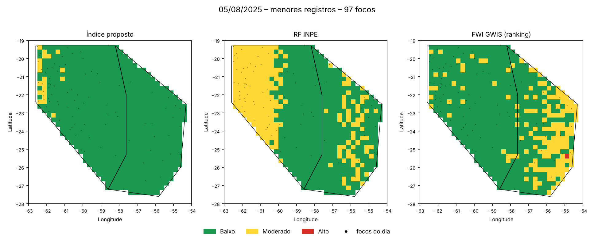

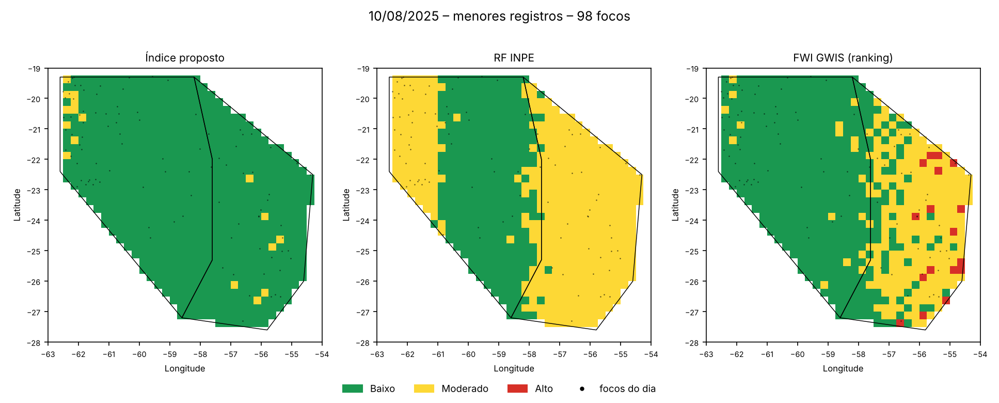

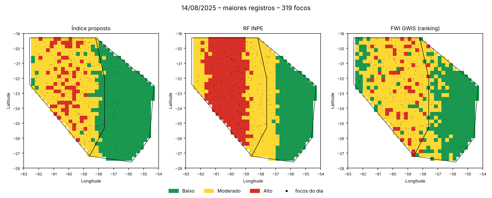

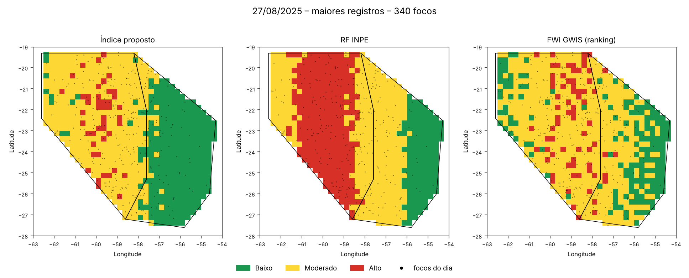

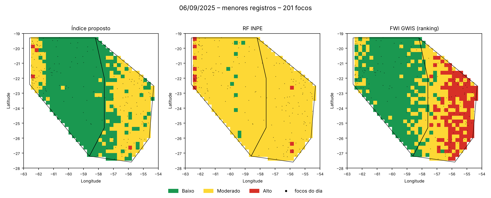

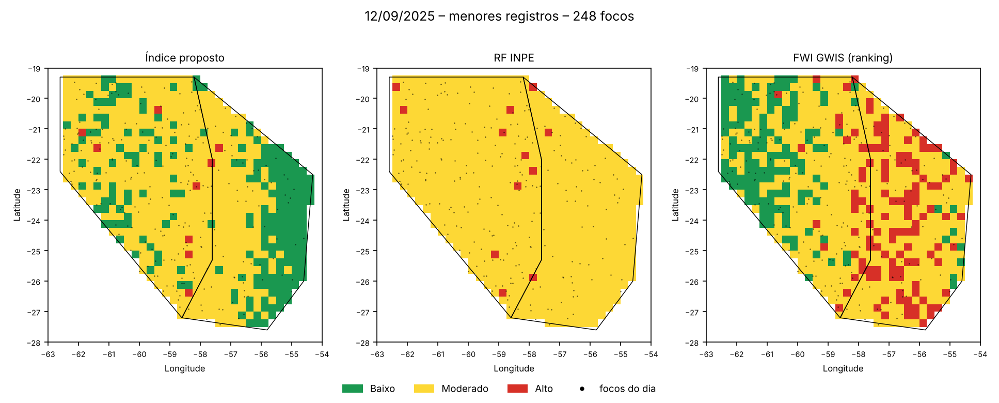

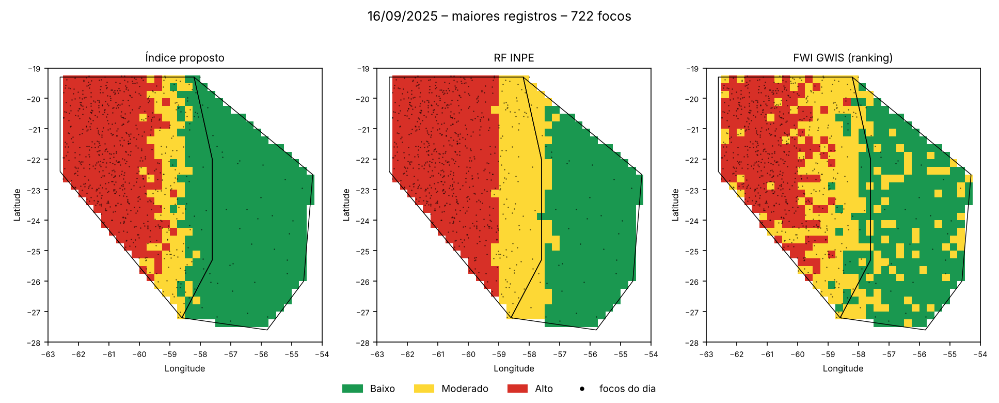

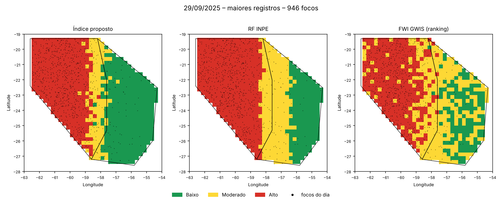
